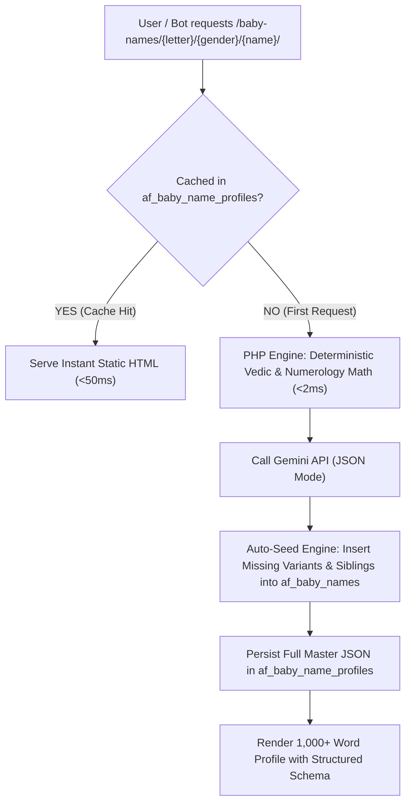
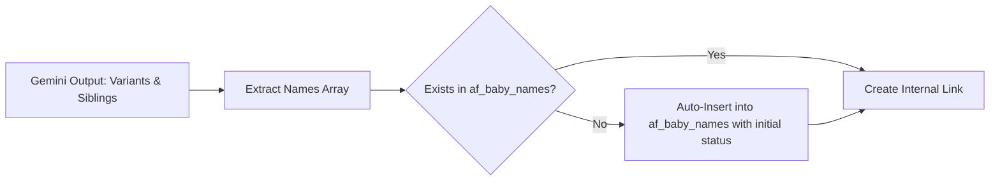

# MeraRashifal Baby Name Engine: Product Architecture & Technical Specification

---

## 1. Product Overview & Strategic Goals

The **Baby Name Section** is the highest-volume organic acquisition funnel for **MeraRashifal.com**. This specification outlines the complete redesign of the section, solving historical crawl and indexing limitations while building a self-expanding, AI-enriched astrological portal.

### Key Performance Indicators (KPIs)
* **Depth:** 800–1,200 words per single name profile (eliminates Google Search Console "Thin content" / "Crawled - Currently Not Indexed" flags).
* **Speed:** < 50ms response for cached profiles; zero UI freeze on first generation.
* **Accuracy:** 100% deterministic calculation for Vedic astrology (Rashi, Nakshatra, Graha Swami) and Chaldean numerology to prevent AI hallucinations.
* **Cost Efficiency:** ~₹0.023 ($0.00027) per unique name generation using Gemini 1.5/2.0 Flash with permanent write-through caching.
* **Self-Expanding Database:** Automated seeding of newly discovered variant spellings and sibling names into `af_baby_names`.

---

## 2. The Hybrid Execution Architecture



1. **Step 1 (Deterministic Vedic Core):** PHP computes Rashi, Nakshatra, Graha Swami, Pada, Chaldean Number, and Auspicious Attributes instantly.
2. **Step 2 (AI Enrichment):** Google Gemini 1.5/2.0 Flash generates Devanagari script, IPA phonetics, cultural etymology, psychological insights, diaspora appeal, and FAQs.
3. **Step 3 (Write-Through Cache):** Full payload is stored as JSON in `af_baby_name_profiles`.
4. **Step 4 (Database Self-Expansion):** Any suggested variants, brother names, or sister names not already in `af_baby_names` are automatically inserted.

---

## 3. Auto-Seeding / Self-Expanding Database Pipeline

To guarantee that internal recommendation links never 404, the system implements an automated seeding pipeline:



### Auto-Seed Logic:
* When a name profile is generated, the pipeline inspects:
  - `global_metadata.variant_spellings`
  - `sibling_recommendations.brother_names`
  - `sibling_recommendations.sister_names`
* For each name:
  ```php
  $exists = $wpdb->get_var($wpdb->prepare("SELECT id FROM af_baby_names WHERE LOWER(name) = LOWER(%s)", $rec_name));
  if (!$exists) {
      $wpdb->insert('af_baby_names', [
          'name'                 => ucfirst(trim($rec_name)),
          'gender'               => $derived_gender, // e.g. Boy for brother, Girl for sister
          'starting_letter'      => strtoupper(substr($rec_name, 0, 1)),
          'meaning'              => 'Traditional ' . $religion . ' name associated with ' . $parent_name,
          'religion'             => $religion,
          'score'                => 50, // default starter score
          'numerology_processed' => 0
      ]);
  }
  ```
* **Result:** Every recommendation links to an actual, functional route on the site.

---

## 4. API Cost & Unit Economics

* **Model:** Gemini 1.5 Flash / Gemini 2.0 Flash
* **Input Token Price:** \$0.075 / 1M tokens
* **Output Token Price:** \$0.30 / 1M tokens

### Cost Matrix per Single Name

$$\begin{aligned}
\text{Input (450 tokens)} &= 450 \times \$0.000000075 = \$0.00003375 \\
\text{Output (800 tokens)} &= 800 \times \$0.000000300 = \$0.00024000 \\
\hline
\mathbf{\text{Total Cost per Name}} &= \mathbf{\$0.00027375\text{ USD}} \approx \mathbf{\text{₹0.023 INR (approx. 2.3 paise)}}
\end{aligned}$$

* **1,000 Unique Names:** \$0.27 (₹23 INR)
* **10,000 Unique Names:** \$2.74 (₹233 INR)
* **Free Tier Allowance:** 15 RPM / 1,500 requests per day via Google AI Studio ($0 cost for initial traffic).

---

## 5. Master JSON Data Schema

```json
{
  "name": "Tushar",
  "script": "तुषार",
  "primary_origin": "Hindu / Sanskrit",
  "gender_suitability": "Male Only",
  "popularity_badge": "Trending Classic",
  
  "etymology": {
    "literal_meaning": "Snow, frost, winter mist, or fine droplets of water",
    "syllables": ["Tu", "shar"],
    "syllable_count": 2,
    "ipa_pronunciation": "/tʊˈʃɑːr/",
    "phonetic_respelling": "Too-shahr"
  },
  
  "vedic_astrology": {
    "rashi_moon_sign": "Tula (Libra)",
    "rashi_hindi": "तुला",
    "ruling_planet": "Venus (Shukra)",
    "nakshatra": "Chitra / Swati",
    "nakshatra_pada": 3,
    "vedic_element": "Air (Vayu)",
    "auspicious_starting_syllable": "Tu-",
    "rashi_deity": "Goddess Lakshmi",
    "favorable_rashis_and_elements": "Highly favorable for fiery and air signs..."
  },
  
  "numerology": {
    "chaldean_number": 3,
    "pythagorean_number": 6,
    "expression_number": 3,
    "soul_urge_number": 4,
    "personality_number": 8,
    "life_path_resonance": "Aligns with numbers representing creative expression and intellectual leadership."
  },
  
  "auspicious_attributes": {
    "lucky_numbers": [3, 6, 9],
    "lucky_colors": ["White", "Light Blue", "Silver"],
    "lucky_days": ["Friday", "Wednesday"],
    "lucky_gemstone": "Diamond / White Sapphire (Heera / Safed Pukhraj)",
    "lucky_metal": "Silver",
    "favorable_direction": "West"
  },
  
  "personality_and_character_insights": "Individuals named Tushar often embody the serene yet resilient qualities of their namesake...",
  "career_and_success_predictions": "With numerological markers highlighting responsibility, innovation, and structure...",
  
  "global_metadata": {
    "popularity_india": "High (Traditional Classic across North and West India)",
    "popularity_us": "Unique and Distinctive Heritage Name",
    "variant_spellings": ["Tushaar", "Toushar", "Tooshar"],
    "nicknames": ["Tushi", "Tush", "Ash"],
    "dual_market_appeal": "In the Indian domestic market, Tushar holds a cherished place..."
  },
  
  "sibling_recommendations": {
    "brother_names": ["Tanmay", "Tarun", "Tejas", "Tanush"],
    "sister_names": ["Trisha", "Tanya", "Tanvi", "Tara"]
  },
  
  "faqs": [
    {
      "question": "What is the meaning and origin of the name Tushar?",
      "answer": "The name Tushar originates from Sanskrit and literally translates to snow, frost, winter mist..."
    },
    {
      "question": "Which Rashi and Nakshatra govern the name Tushar?",
      "answer": "According to Vedic astrology, names starting with 'Tu' belong to Tula Rashi (Libra)..."
    },
    {
      "question": "What is the lucky numerology number for Tushar?",
      "answer": "In Vedic Chaldean numerology, Tushar holds a primary vibration of 3..."
    }
  ]
}
```

---

## 6. Database Storage Schema

```sql
CREATE TABLE IF NOT EXISTS `af_baby_name_profiles` (
    `id` BIGINT UNSIGNED AUTO_INCREMENT PRIMARY KEY,
    `baby_name_id` BIGINT UNSIGNED NOT NULL UNIQUE,
    `name_slug` VARCHAR(255) NOT NULL,
    `gender` VARCHAR(20) NOT NULL,
    `religion` VARCHAR(100) DEFAULT 'Hindu',
    `rashi` VARCHAR(100),
    `nakshatra` VARCHAR(100),
    `numerology_number` INT,
    `profile_json` LONGTEXT NOT NULL,
    `word_count` INT DEFAULT 0,
    `created_at` TIMESTAMP DEFAULT CURRENT_TIMESTAMP,
    `updated_at` TIMESTAMP DEFAULT CURRENT_TIMESTAMP ON UPDATE CURRENT_TIMESTAMP,
    INDEX `idx_slug` (`name_slug`),
    INDEX `idx_rel_gender` (`religion`, `gender`),
    FOREIGN KEY (`baby_name_id`) REFERENCES `af_baby_names`(`id`) ON DELETE CASCADE
) ENGINE=InnoDB DEFAULT CHARSET=utf8mb4 COLLATE=utf8mb4_unicode_ci;
```

---

## 7. Frontend Layout: The 11-Section Blueprint

1. **Header & Badges:** Title, Devanagari script, gender, religion, and popularity status.
2. **Linguistic Etymology:** Root language, literal definition, syllable count, and phonetic respelling.
3. **Vedic Astrology Module:** Moon Sign (Rashi), Nakshatra & Charan, Lord Planet, Element, and Deity.
4. **Numerology Matrix:** Chaldean Destiny, Pythagorean Expression, Soul Urge, and Life Path resonance.
5. **Auspicious Attributes Table:** Lucky days, colors, gemstones, metals, and directions.
6. **Psychological & Character Traits:** Deep behavioural narrative synthesized from Rashi + Numerology.
7. **Career & Success Outlook:** Natural aptitudes, vocational strengths, and leadership potential.
8. **Zodiac Compatibility:** Harmonious signs for family and partnership equilibrium.
9. **Sibling & Variant Links:** Interactive pill tags linking to automatically validated brother, sister, and variant name pages.
10. **Astro Action Hub:** CTAs for Free Baby Kundli, Lo-Shu Grid calculation, and Aaj Ka Rashifal.
11. **Bilingual FAQ Section:** 5 targeted questions with embedded JSON-LD `FAQPage` schema.

---

## 8. Clean URL Taxonomy

* **Religion Hubs:** `/baby-names/hindu/`, `/baby-names/muslim/`, `/baby-names/christian/`, `/baby-names/sikh/`
* **Gender Hubs:** `/baby-names/hindu/boy/`, `/baby-names/hindu/girl/`
* **Alphabet Hubs:** `/baby-names/t/`, `/baby-names/t/boy/`
* **Detail Pages:** `/baby-names/t/boy/tushar/`
* **Parameter Policy:** All filter parameters (`?religion=...`) are canonicalized to clean hubs and marked `noindex, follow` in accordance with Search Console requirements.

---

## 9. Implementation Roadmap

- [x] **Step 1:** Create `af_baby_name_profiles` table in database.
- [x] **Step 2:** Build deterministic Vedic Astrology & Chaldean Numerology calculation library (`MR_Baby_Astro_Engine`).
- [x] **Step 3:** Implement Gemini API prompt service with JSON-schema output validation and auto-seeding hook for missing sibling/variant names into `af_baby_names`.
- [x] **Step 4:** Build responsive 11-section template delivering 800–1,200 words.
- [x] **Step 5:** Add rewrite rules for clean religion hubs (`/baby-names/hindu/`, etc.) and register in XML sitemaps.

